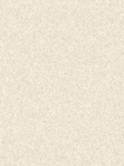

# Oil Pastel

Transforma uma foto numa pintura de giz pastel oleoso, pintada ao vivo em camadas
(pinceladas grossas primeiro, depois cada vez mais finas).



## Como usar

```bash
pip install pillow numpy
python pastel.py girassois.jpg
```

Outras opções:

```bash
# salva a pintura final e um GIF do processo
python pastel.py foto.jpg --save pintura.png --gif processo.gif

# só gera o arquivo, sem abrir a janela
python pastel.py foto.jpg --no-window --save pintura.png

# repete a pintura sem parar, 12 s cada
python pastel.py foto.jpg --loop --duration 12
```

A janela lembra onde você a deixou da última vez (arraste para onde quiser).

Os ajustes (cor do papel, saturação, tamanho das pinceladas, camadas) ficam no topo de `pastel.py`.
